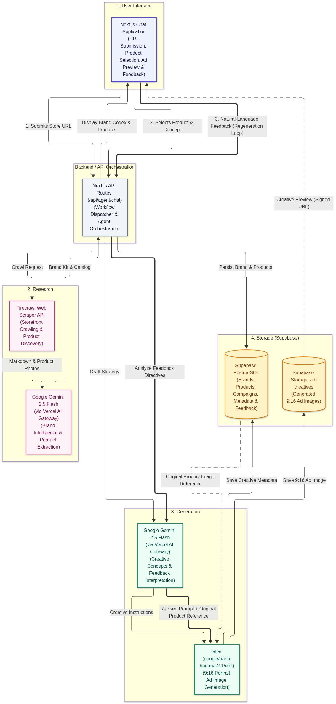
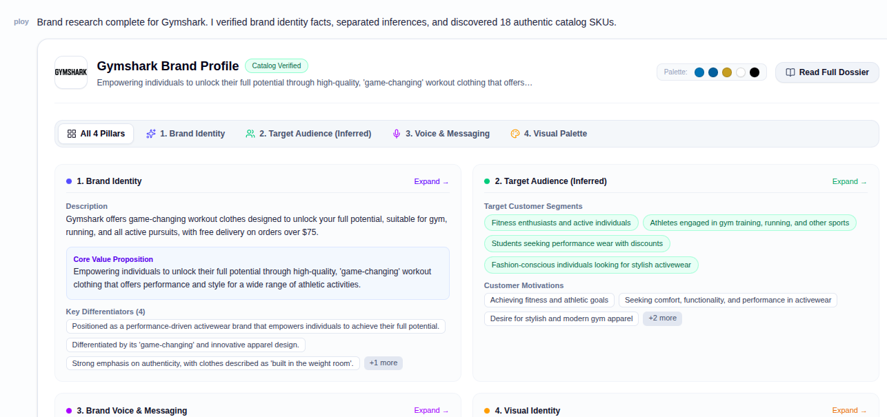
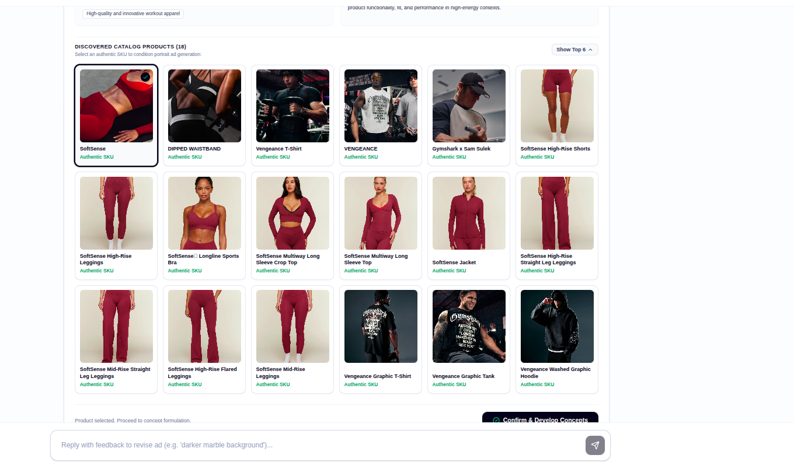
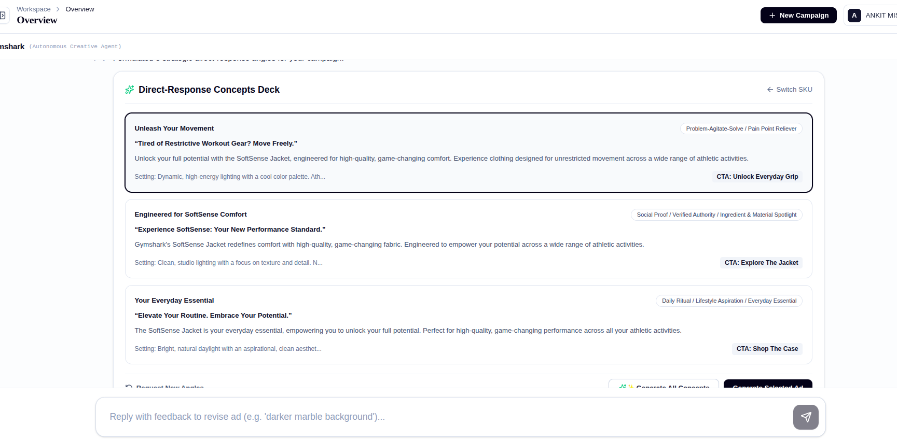
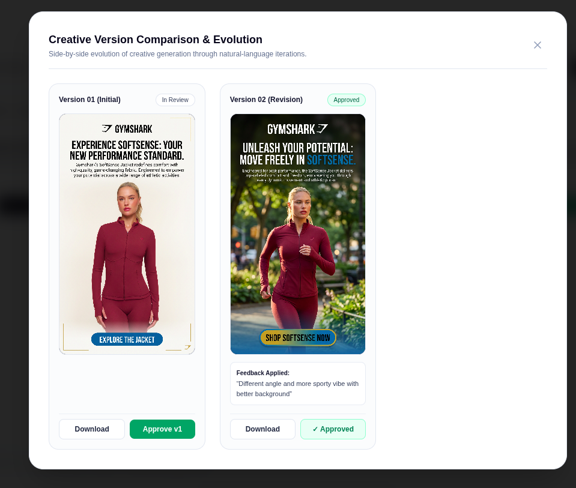
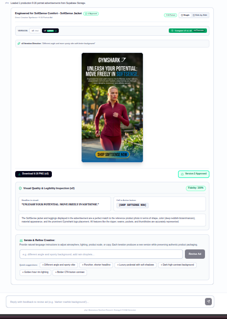

# Cadra — AI Ads Manager

An agentic, multi-stage AI advertising workspace for ecommerce storefronts.

A user inputs an ecommerce store URL. The Cadra agent investigates the brand, discovers authentic products, synthesizes a grounded Brand Kit, formulates direct-response advertising concepts, and generates finished 9:16 portrait advertisements via **fal.ai** (`google/nano-banana-2.1/edit`). The creative director reviews the ad and enables human-in-the-loop revision through natural-language iteration.

---

## System Architecture



---

## User Interface & Workflow Showcase

### 1. Storefront Input & Interactive Welcome
Marketer inputs a live ecommerce storefront URL (e.g., Shopify store) to initiate multi-page brand research and catalog discovery.



---

### 2. Structured Advertising Intelligence & Product Selection
Brand intelligence cleanly separates verified facts (official logos, extracted CSS hex codes, product catalog) from inferred insights (target personas, brand archetypes) with visible `INFERRED` badges. Marketer selects the hero product before proceeding.



---

### 3. Distinct Advertising Angles (3 Concepts)
Gemini formulates three strategically orthogonal direct-response concepts (Problem-Solution, Social Proof / Lifestyle, Brand Narrative), each complete with hook headline, supporting copy, CTA, and visual directive.



---

### 4. fal.ai Native 9:16 Portrait Ad Generation
Conditioned on authentic product photography and strategic visual directives, fal.ai (`google/nano-banana-2.1/edit`) synthesizes complete 9:16 portrait advertisements with embedded typography and CTA buttons.



---

### 5. Version-Based Creative Iteration & Feedback Loop
Marketers submit natural-language revision directives to adjust atmosphere, lighting, or angle. All versions (v1, v2) are durably preserved in Supabase Storage with side-by-side comparison.



---

## The 5 Core Product Decisions

1. **Structured Advertising Intelligence**: Distinguishes verified facts from inferred insights with epistemic confidence tags and visual badges.
2. **Version-Based Creative Iteration**: Preserves previous versions (v1, v2), with side-by-side comparison and feedback-driven prompt adjustment while retaining authentic product references.
3. **Human Checkpoints**: Mandatory human-in-the-loop checkpoints: product selection and concept approval are required before generation begins.
4. **Distinct Advertising Angles**: Formulates 3 orthogonal concepts with headline, supporting copy, CTA, and visual directive.
5. **Separation of Strategy and Generation**: Gemini formulates creative strategy; fal.ai synthesizes the 9:16 image conditioned on the real product photo.

---

## Technology Stack

- **Framework**: Next.js 16.4 (App Router, Turbopack, React 19, TypeScript 5, Tailwind CSS v4)
- **Agent Orchestration**: Vercel AI SDK (`ai`, `@ai-sdk/google`, `@ai-sdk/react`)
- **LLM Reasoning**: Google Gemini 2.5 Flash via `@ai-sdk/google`
- **Storefront Research**: Firecrawl Scraper API (`/v1/scrape`)
- **Image Generation**: fal.ai (`google/nano-banana-2.1/edit`)
- **Database & Storage**: Supabase PostgreSQL + Private Supabase Storage (`ad-creatives`)

---

## Getting Started

### Prerequisites
- Node.js 20+
- Supabase project
- Firecrawl API key
- Google Gemini API key
- fal.ai API key

### Local Setup
```bash
# Install dependencies
npm install

# Run database migrations from supabase/migrations/ in your Supabase SQL editor

# Start development server
npm run dev
```

Open [http://localhost:3000](http://localhost:3000) to start the workspace.
